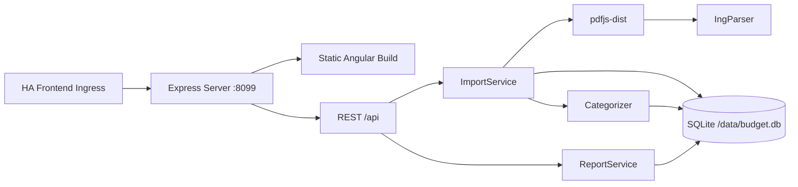

# Mitwirken am Haushaltsbuch

Danke für dein Interesse! Dieses Dokument beschreibt die lokale Entwicklung des Add-ons.
Der Quellcode liegt im Verzeichnis [`budget_tracker/`](budget_tracker); alle Befehle werden dort
ausgeführt.

## Repository-Struktur

Das Repository folgt dem Aufbau eines Home Assistant Add-on Repositorys:

```
repository.yaml              # Metadaten des Add-on Repositorys
README.md                    # Übersicht des Repositorys
budget_tracker/              # Add-on „Haushaltsbuch“
  config.yaml                # Add-on-Konfiguration (Version, Architekturen, Ingress)
  Dockerfile                 # Multi-Stage Build (node:24-alpine)
  README.md                  # Kurzbeschreibung (Info-Tab im Add-on Store)
  DOCS.md                    # Benutzer-Dokumentation (Tab „Dokumentation“)
  CHANGELOG.md               # Änderungen pro Version (Tab „Changelog“, Release Notes)
  shared/api-types.ts        # Gemeinsame DTOs
  server/                    # Express-Backend (TypeScript)
    src/main.ts              # Entry Point, Port 8099
    src/db/                  # SQLite-Schema, Seed-Daten
    src/parsing/             # PDF-Textextraktion, ING-Parser
    src/categorization/      # Regelbasierte Kategorisierung
    src/services/            # Import, Reports
    src/routes/              # REST-API-Endpunkte
    test/                    # Server-Tests
  src/                       # Angular-Frontend
    app/core/                # ApiService, Format-Helfer, Theme
    app/features/            # Feature-Komponenten (Upload, Übersicht, …)
    app/shared/              # Chart-Wrapper
```

## Lokale Entwicklung

Voraussetzungen: Node.js ≥ 24, npm.

```bash
cd budget_tracker
npm install
```

### Frontend + Backend gleichzeitig

```bash
# Terminal 1: Angular Dev-Server (mit API-Proxy zum Backend)
npm start

# Terminal 2: Express-Backend
npm run dev:server
```

Öffne `http://localhost:4200/`. Der Proxy leitet `/api/*` an `http://localhost:8099` weiter.

### Build

```bash
npm run build:all     # Frontend + Backend
npm run build         # Nur Frontend
npm run build:server  # Nur Backend
```

### Tests & Code-Qualität

```bash
npm run test:server   # Server-Tests (Vitest)
npm test              # Angular-Tests
npm run lint          # ESLint
npm run format:check  # Prettier
npm run typecheck     # TypeScript
npm run check         # Alle Prüfungen auf einmal
```

Die Workflows [CI – Build & Tests](.github/workflows/ci.yml) und
[Code Quality](.github/workflows/code-quality.yml) führen diese Prüfungen bei jedem Push und
Pull Request auf `main` aus.

### Docker-Image bauen

```bash
docker build -t budget-tracker budget_tracker
```

## Architektur



- **Frontend**: Angular 22 mit Signal-basierten Komponenten, Chart.js für Diagramme
- **Backend**: Node.js/Express (TypeScript), SQLite über `node:sqlite`
- **PDF-Parser**: pdfjs-dist mit ING-spezifischem Layout-Parser
- **Container**: Ein Docker-Container liefert das Angular-Frontend statisch aus und stellt die
  REST-API bereit

## Release

1. Version in `budget_tracker/config.yaml` erhöhen.
2. Abschnitt `## <Version> (<Datum>)` in `budget_tracker/CHANGELOG.md` ergänzen.
3. Tag `v<Version>` pushen – der Workflow [Automated Release](.github/workflows/release.yml)
   erstellt das GitHub-Release mit den Release Notes aus dem Changelog.

## Lizenzen der Abhängigkeiten

- Angular: MIT
- Express: MIT
- pdfjs-dist: Apache-2.0
- chart.js: MIT
