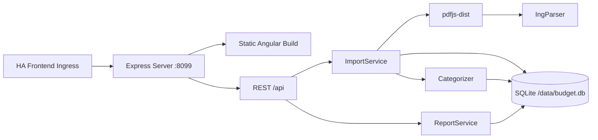

# Haushaltsbuch – HomeAssistant Addon

Monatlich einen ING-Kontoauszug (PDF) hochladen, Transaktionen automatisch kategorisieren und als Diagramme darstellen. Läuft als HomeAssistant-Addon über Ingress.

[Dokumentation](DOCS.md) · [Changelog](CHANGELOG.md)

## Lokale Entwicklung

Voraussetzungen: Node.js ≥ 24, npm.

```bash
npm install
```

### Frontend + Backend gleichzeitig

```bash
# Terminal 1: Angular Dev-Server (mit API-Proxy zum Backend)
npm start

# Terminal 2: Express-Backend
npm run dev:server
```

Öffne `http://localhost:4200/`. Der Proxy leitet `/api/*` an `http://localhost:8099` weiter.

### Build

```bash
# Frontend + Backend bauen
npm run build:all

# Nur Frontend
npm run build

# Nur Backend
npm run build:server
```

### Tests

```bash
# Server-Tests (Vitest)
npm run test:server

# Angular-Tests
ng test
```

### Docker-Image bauen

```bash
docker build -t budget-tracker .
```

## Projektstruktur

```
config.yaml              # HA-Addon-Konfiguration
Dockerfile               # Multi-Stage Build (node:24-alpine)
shared/api-types.ts      # Gemeinsame DTOs
server/                  # Express-Backend (TypeScript)
  src/main.ts            # Entry Point, Port 8099
  src/db/                # SQLite-Schema, Seed-Daten
  src/parsing/           # PDF-Textextraktion, ING-Parser
  src/categorization/    # Regelbasierte Kategorisierung
  src/services/          # Import, Reports
  src/routes/            # REST-API-Endpunkte
  test/                  # Server-Tests
src/                     # Angular-Frontend
  app/core/              # ApiService, Format-Helfer
  app/features/          # Feature-Komponenten (Upload, Übersicht, etc.)
  app/shared/            # Chart-Wrapper
```

## Architektur



## Lizenzen

- Angular: MIT
- Express: MIT
- pdfjs-dist: Apache-2.0
- chart.js: MIT
